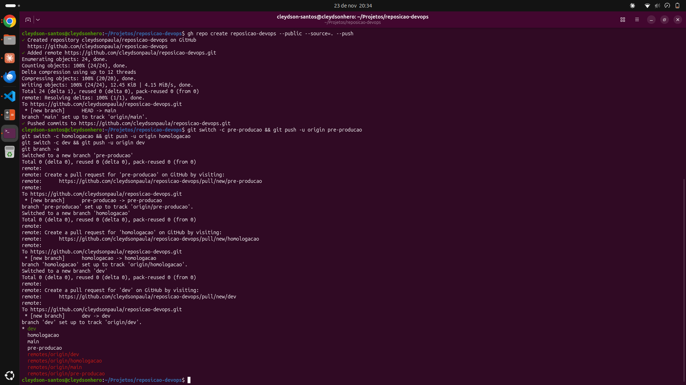
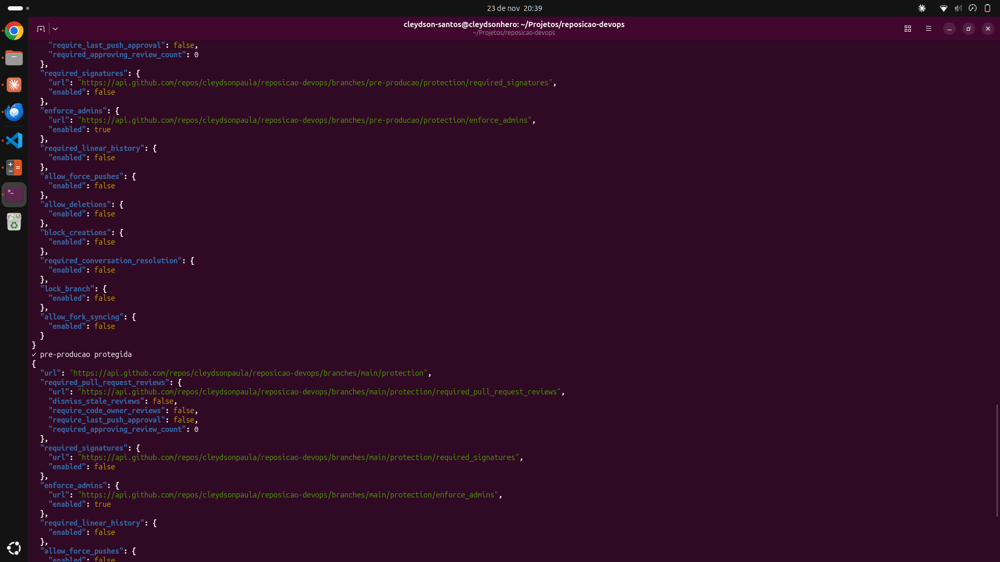
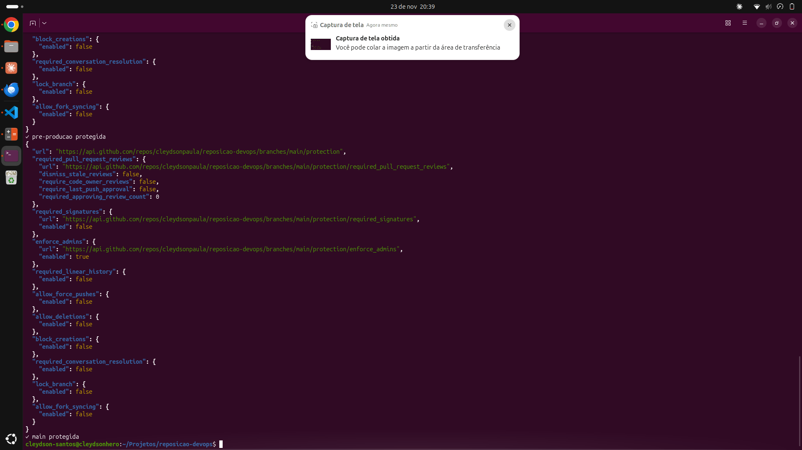
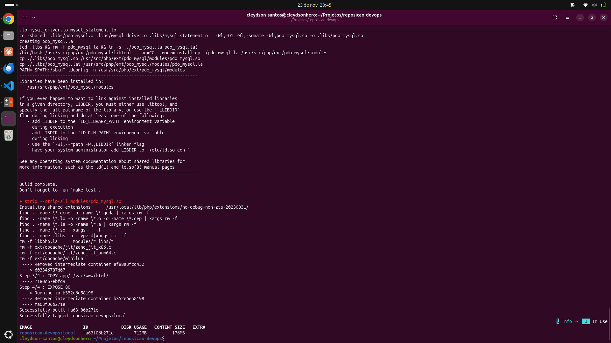
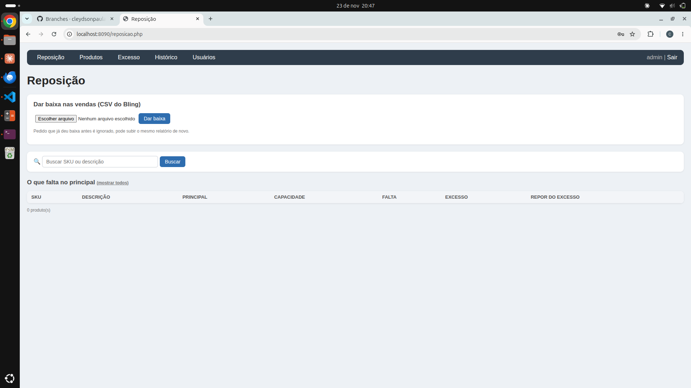

# Relatório — Esteira de entrega contínua do sistema Reposição Simples

**Aluno:** Cleydson Paula
**Repositório:** https://github.com/cleydsonpaula/reposicao-devops

## Objetivo

Montar uma esteira de entrega contínua para uma aplicação web (PHP + MySQL), com quatro ambientes
separados por branch no GitHub, construção e implantação automáticas pelo Jenkins (Multibranch Pipeline),
execução em contêineres orquestrados pelo Kubernetes e centralização dos logs no Elasticsearch, com
visualização no Kibana.

## Visão geral da arquitetura

```
GitHub (4 branches)
  dev ──► homologacao ──► pre-producao ──► main (produção)
        (promoção por pull request)
            │
            ▼
Jenkins (contêiner) ── Multibranch Pipeline ── lê o Jenkinsfile de cada branch
            │  constrói a imagem Docker → testa → publica → implanta
            ▼
Kubernetes (kind — cluster local dentro do Docker)
  namespace dev │ homologacao │ pre-producao │ producao
            │  logs dos contêineres
            ▼
Fluent Bit ──► Elasticsearch ──► Kibana
```

## Fundamentos

**Contêineres (Docker).** Empacotam a aplicação com tudo de que ela precisa para rodar, garantindo que
funcione igual em qualquer máquina. A receita fica no `Dockerfile`, que gera uma *imagem*; cada cópia em
execução da imagem é um *contêiner*.

**Kubernetes (K8s).** Orquestra os contêineres: decide onde cada um roda, mantém o número de cópias,
reinicia os que caem, distribui o tráfego e atualiza versões sem tirar o sistema do ar. É configurado por
arquivos YAML. Um *namespace* separa os recursos de cada ambiente dentro do mesmo cluster.

**Jenkins.** Automatiza a integração e a entrega contínuas (CI/CD): a cada alteração no código, testa,
gera a imagem Docker e publica no Kubernetes, seguindo os passos descritos no `Jenkinsfile`.

**Multibranch Pipeline.** Recurso do Jenkins que cria automaticamente um pipeline para cada branch do
repositório, permitindo comportamentos diferentes por branch a partir de um único `Jenkinsfile`.

**Elasticsearch e Kibana.** O Elasticsearch armazena e pesquisa os logs dos contêineres; o Kibana é a
interface visual para filtrar, criar gráficos e painéis — por exemplo, ver só os erros de produção. Junto
com um coletor de logs (aqui, o Fluent Bit) formam a pilha EFK (Elasticsearch, Fluent Bit, Kibana).

### Os quatro ambientes

Cada branch corresponde a um ambiente e a um namespace no Kubernetes. Um único `Jenkinsfile` identifica a
branch que mudou e publica no namespace certo; antes da produção, o pipeline **para e espera aprovação
manual**.

| Branch | Namespace | Publicação |
|---|---|---|
| `dev` | `dev` | automática |
| `homologacao` | `homologacao` | automática |
| `pre-producao` | `pre-producao` | automática |
| `main` | `producao` | **após aprovação manual** no Jenkins |

## A aplicação

O **Reposição Simples** é um sistema de controle de estoque: importa as vendas (arquivo CSV exportado do
ERP), dá baixa no estoque e controla a reposição do endereço principal de cada produto a partir do
estoque de excesso. É composto por um servidor web (PHP 8.3 + Apache) e um banco MySQL 8.0.

---

## Etapa 1 — Repositório e estratégia de branches

### O que foi feito

1. Conferido o acesso ao GitHub pela linha de comando (`gh auth status`).
2. Criado um repositório novo a partir do código da aplicação, **sem o histórico anterior** e **sem o
   arquivo de produtos da empresa** (o repositório é público — dado real de empresa não deve ser publicado).
3. Publicado no GitHub e criadas as quatro branches de ambiente.

### Comandos

```bash
# login no GitHub pela linha de comando
gh auth status

# pasta nova com o código da aplicação
mkdir ~/Projetos/reposicao-devops && cd ~/Projetos/reposicao-devops
cp -r ../reposicao-simples/app ../reposicao-simples/db ../reposicao-simples/docker-compose.yml \
      ../reposicao-simples/.gitignore ../reposicao-simples/README.md .

# repositório git local e primeiro commit
git init -b main
git add .
git commit -m "chore: projeto inicial a partir do reposicao-simples"

# cria o repositório público no GitHub e envia a main
gh repo create reposicao-devops --public --source=. --push

# as outras três branches, criadas a partir da main
git switch -c pre-producao && git push -u origin pre-producao
git switch -c homologacao  && git push -u origin homologacao
git switch -c dev          && git push -u origin dev
git branch -a
```

| Comando | Para que serve |
|---|---|
| `git init -b main` | Inicia o controle de versão na pasta, com a branch principal `main` |
| `git add .` / `git commit` | Registra o estado atual dos arquivos (um "commit") |
| `gh repo create ... --push` | Cria o repositório no GitHub e envia o código |
| `git switch -c X` | Cria a branch X a partir da atual e passa a trabalhar nela |
| `git push -u origin X` | Envia a branch ao GitHub e liga a branch local à remota |

### Estratégia de branches

| Branch | Ambiente | Papel |
|---|---|---|
| `dev` | Desenvolvimento | Onde o código é escrito; recebe as alterações primeiro |
| `homologacao` | Homologação | Validação funcional — confere se o que foi pedido está correto |
| `pre-producao` | Pré-produção | Cópia fiel da produção; último ensaio antes de liberar |
| `main` | Produção | Versão usada pelo cliente final |

O código **sobe** sempre na mesma ordem, por *pull request*:

```
dev  →  homologacao  →  pre-producao  →  main
```

Assim, nada chega à produção sem antes passar pelos outros três ambientes.

### Cuidado com segurança

Antes de tornar o repositório público, os arquivos foram conferidos: só há senhas de teste do ambiente
local (usuário `simples`, `root`, `admin`). Os arquivos `.csv` (dados de vendas) estão no `.gitignore` e
nunca entram no repositório. Na etapa do Kubernetes as senhas passam para *Secrets*.

### Proteção das branches

Para garantir que o fluxo seja respeitado, as branches `homologacao`, `pre-producao` e `main` foram
protegidas: só recebem código por *pull request*. A `dev` fica livre, pois é onde o desenvolvimento
acontece. A regra foi aplicada pela API do GitHub:

```bash
for b in homologacao pre-producao main; do
gh api -X PUT repos/cleydsonpaula/reposicao-devops/branches/$b/protection --input - <<'EOF'
{"required_status_checks": null,
 "enforce_admins": true,
 "required_pull_request_reviews": {"required_approving_review_count": 0},
 "restrictions": null}
EOF
echo "✓ $b protegida"; done
```

| Regra | Efeito |
|---|---|
| `required_pull_request_reviews` | Código só entra por *pull request* (0 aprovações: trabalho individual — o GitHub não permite aprovar o próprio PR) |
| `enforce_admins: true` | A regra vale também para o dono do repositório |
| `allow_force_pushes: false` | Ninguém reescreve o histórico da branch |
| `allow_deletions: false` | A branch não pode ser apagada |

Na Etapa 4 a regra ganha mais uma exigência: o *pull request* só poderá ser aceito se o pipeline do
Jenkins tiver passado (*status check*).

### Teste da proteção

Para provar que a regra funciona, foi feito um commit vazio direto na `main` e tentado o envio. O GitHub
recusou:

```
remote: error: GH006: Protected branch update failed for refs/heads/main.
remote: - Changes must be made through a pull request.
 ! [remote rejected] main -> main (protected branch hook declined)
```

Depois do teste, a `main` local voltou a ficar igual à do GitHub com `git reset --hard origin/main`.

### Problema encontrado

Na primeira tentativa do teste, o `git switch main` foi **abortado** porque havia uma alteração ainda não
registrada no `docs/relatorio.md` — o Git não troca de branch quando isso poderia sobrescrever trabalho
não salvo. Como os comandos seguintes rodaram mesmo assim, o commit vazio de teste foi feito na `dev`
(que não é protegida) e enviado. O commit não altera nenhum arquivo, então foi mantido no histórico.

**Lição:** antes de trocar de branch, conferir com `git status` e registrar (commit) o que estiver pendente.

### Evidências









---

## Etapa 2 — Contêiner da aplicação

### O que foi feito

1. Escrito o `Dockerfile`, a "receita" que empacota a aplicação numa **imagem**.
2. Criado o `.dockerignore`, para que arquivos que não fazem parte da aplicação não entrem na imagem.
3. A conexão com o banco (`app/inc/conexao.php`) passou a ler os dados de **variáveis de ambiente**.
4. O `docker-compose.yml` passou a construir a imagem a partir do `Dockerfile`.
5. Construída a imagem, executados os contêineres (aplicação + banco) e testado o acesso pelo navegador.

### Dockerfile

```dockerfile
FROM php:8.3-apache                     # imagem oficial: PHP 8.3 com servidor Apache
RUN docker-php-ext-install pdo_mysql    # extensão que liga o PHP ao MySQL
COPY app/ /var/www/html/                # código da aplicação dentro da imagem
EXPOSE 80                               # a aplicação atende na porta 80
```

Antes, o contêiner usava a imagem pura do PHP e instalava a extensão do MySQL **toda vez que ligava**.
Agora a extensão e o código ficam **dentro da imagem**: o contêiner liga pronto e se comporta igual em
qualquer máquina — no computador, no Jenkins ou no Kubernetes.

O `.dockerignore` exclui da imagem a pasta `.git`, a documentação (`docs`) e os arquivos `.csv`.

### Configuração por variáveis de ambiente

A conexão estava escrita no código (`host=db`, usuário e senha fixos). Para que **a mesma imagem** sirva
aos quatro ambientes — cada um com seu banco e sua senha —, ela passou a ler as variáveis `DB_HOST`,
`DB_NAME`, `DB_USER` e `DB_PASS`:

```php
$host  = getenv('DB_HOST') ?: 'db';
$banco = getenv('DB_NAME') ?: 'simples';
$user  = getenv('DB_USER') ?: 'simples';
$senha = getenv('DB_PASS') ?: 'simples';
```

Esse princípio — a imagem é a mesma em todos os ambientes, o que muda é a configuração — é um dos fatores
do *Twelve-Factor App* e é o que permite promover exatamente o mesmo artefato de `dev` até `producao`.

### Comandos

```bash
docker build -t reposicao-devops:local .   # constrói a imagem a partir do Dockerfile
docker images reposicao-devops             # confere a imagem criada
docker compose up -d                       # liga aplicação e banco em segundo plano
docker compose ps                          # confere se os contêineres estão no ar
```

| Comando | Para que serve |
|---|---|
| `docker build -t nome:etiqueta .` | Lê o `Dockerfile` da pasta atual e gera a imagem com esse nome |
| `docker images` | Lista as imagens e o tamanho de cada uma |
| `docker compose up -d` | Cria a rede, o volume do banco e liga os contêineres descritos no `docker-compose.yml` |
| `docker compose ps` | Mostra os contêineres, o estado (`Up`) e as portas |

### Resultado

- Imagem `reposicao-devops:local` construída em 4 passos, com 176 MB de conteúdo próprio.
- Contêineres `devops-web` (aplicação, porta 8090) e `devops-db` (MySQL 8.0) no ar.
- Aplicação acessível em `http://localhost:8090`, com login funcionando (o login consulta o banco, o que
  confirma a conexão entre os dois contêineres).

### Observações

- A porta 8081, usada originalmente, já estava ocupada por outro sistema na máquina; a aplicação passou a
  usar a **8090**.
- O Docker mostrou o aviso `DEPRECATED: The legacy builder is deprecated`. Não é erro: indica que existe
  uma ferramenta de build mais nova (BuildKit/buildx). A construção funcionou normalmente.

### Evidências





