# Relatório — Esteira de entrega contínua do sistema Reposição Simples

**Aluno:** Cleydson Santos
**Repositório:** https://github.com/cleydsonpaula/reposicao-devops

## Resumo

Este trabalho monta, do zero e inteiramente em ambiente local, uma esteira de integração e entrega
contínuas (CI/CD) para uma aplicação web em PHP + MySQL. O código vive no GitHub em quatro branches —
`dev`, `homologacao`, `pre-producao` e `main` —, promovidas sempre por *pull request*. Um **Jenkins**
com **Multibranch Pipeline** detecta cada mudança, constrói a imagem **Docker**, testa e publica no
ambiente correspondente de um cluster **Kubernetes** (kind), com **aprovação manual antes da produção**.
Os logs de todos os contêineres são coletados pelo **Fluent Bit**, guardados no **Elasticsearch** e
pesquisados no **Kibana**. Ao final, os quatro ambientes rodam versões publicadas pela esteira, e um
simples `git push` dispara todo o ciclo.

## Sumário

1. [Objetivo](#objetivo)
2. [Visão geral da arquitetura](#visão-geral-da-arquitetura)
3. [Fundamentos](#fundamentos)
4. [A aplicação](#a-aplicação)
5. [Etapa 1 — Repositório e estratégia de branches](#etapa-1--repositório-e-estratégia-de-branches)
6. [Etapa 2 — Contêiner da aplicação](#etapa-2--contêiner-da-aplicação)
7. [Etapa 3 — Kubernetes](#etapa-3--kubernetes)
8. [Etapa 4 — Jenkins e Multibranch Pipeline](#etapa-4--jenkins-e-multibranch-pipeline)
9. [Etapa 5 — Logs centralizados: Elasticsearch, Fluent Bit e Kibana](#etapa-5--logs-centralizados-elasticsearch-fluent-bit-e-kibana)
10. [Etapa 6 — Promoção final](#etapa-6--promoção-final)
11. [Como reproduzir](#como-reproduzir)
12. [Conclusão](#conclusão)

## Objetivo

Montar uma esteira de entrega contínua para uma aplicação web (PHP + MySQL), com quatro ambientes
separados por branch no GitHub, construção e implantação automáticas pelo Jenkins (Multibranch Pipeline),
execução em contêineres orquestrados pelo Kubernetes e centralização dos logs no Elasticsearch, com
visualização no Kibana.

## Visão geral da arquitetura

```
GitHub (4 branches)
  dev ──► homologacao ──► pre-producao ──► main (produção)
        (promoção por pull request)
            │
            ▼
Jenkins (contêiner) ── Multibranch Pipeline ── lê o Jenkinsfile de cada branch
            │  constrói a imagem Docker → testa → publica → implanta
            ▼
Kubernetes (kind — cluster local dentro do Docker)
  namespace dev │ homologacao │ pre-producao │ producao
            │  logs dos contêineres
            ▼
Fluent Bit ──► Elasticsearch ──► Kibana
```

## Fundamentos

**Contêineres (Docker).** Empacotam a aplicação com tudo de que ela precisa para rodar, garantindo que
funcione igual em qualquer máquina. A receita fica no `Dockerfile`, que gera uma *imagem*; cada cópia em
execução da imagem é um *contêiner*.

**Kubernetes (K8s).** Orquestra os contêineres: decide onde cada um roda, mantém o número de cópias,
reinicia os que caem, distribui o tráfego e atualiza versões sem tirar o sistema do ar. É configurado por
arquivos YAML. Um *namespace* separa os recursos de cada ambiente dentro do mesmo cluster.

**Jenkins.** Automatiza a integração e a entrega contínuas (CI/CD): a cada alteração no código, testa,
gera a imagem Docker e publica no Kubernetes, seguindo os passos descritos no `Jenkinsfile`.

**Multibranch Pipeline.** Recurso do Jenkins que cria automaticamente um pipeline para cada branch do
repositório, permitindo comportamentos diferentes por branch a partir de um único `Jenkinsfile`.

**Elasticsearch e Kibana.** O Elasticsearch armazena e pesquisa os logs dos contêineres; o Kibana é a
interface visual para filtrar, criar gráficos e painéis — por exemplo, ver só os erros de produção. Junto
com um coletor de logs (aqui, o Fluent Bit) formam a pilha EFK (Elasticsearch, Fluent Bit, Kibana).

### Os quatro ambientes

Cada branch corresponde a um ambiente e a um namespace no Kubernetes. Um único `Jenkinsfile` identifica a
branch que mudou e publica no namespace certo; antes da produção, o pipeline **para e espera aprovação
manual**.

| Branch | Namespace | Publicação |
|---|---|---|
| `dev` | `dev` | automática |
| `homologacao` | `homologacao` | automática |
| `pre-producao` | `pre-producao` | automática |
| `main` | `producao` | **após aprovação manual** no Jenkins |

## A aplicação

O **Reposição Simples** é um sistema de controle de estoque: importa as vendas (arquivo CSV exportado do
ERP), dá baixa no estoque e controla a reposição do endereço principal de cada produto a partir do
estoque de excesso. É composto por um servidor web (PHP 8.3 + Apache) e um banco MySQL 8.0.

---

## Etapa 1 — Repositório e estratégia de branches

### O que foi feito

1. Conferido o acesso ao GitHub pela linha de comando (`gh auth status`).
2. Criado um repositório novo a partir do código da aplicação, **sem o histórico anterior** e **sem o
   arquivo de produtos da empresa** (o repositório é público — dado real de empresa não deve ser publicado).
3. Publicado no GitHub e criadas as quatro branches de ambiente.

### Comandos

```bash
# login no GitHub pela linha de comando
gh auth status

# pasta nova com o código da aplicação
mkdir ~/Projetos/reposicao-devops && cd ~/Projetos/reposicao-devops
cp -r ../reposicao-simples/app ../reposicao-simples/db ../reposicao-simples/docker-compose.yml \
      ../reposicao-simples/.gitignore ../reposicao-simples/README.md .

# repositório git local e primeiro commit
git init -b main
git add .
git commit -m "chore: projeto inicial a partir do reposicao-simples"

# cria o repositório público no GitHub e envia a main
gh repo create reposicao-devops --public --source=. --push

# as outras três branches, criadas a partir da main
git switch -c pre-producao && git push -u origin pre-producao
git switch -c homologacao  && git push -u origin homologacao
git switch -c dev          && git push -u origin dev
git branch -a
```

| Comando | Para que serve |
|---|---|
| `git init -b main` | Inicia o controle de versão na pasta, com a branch principal `main` |
| `git add .` / `git commit` | Registra o estado atual dos arquivos (um "commit") |
| `gh repo create ... --push` | Cria o repositório no GitHub e envia o código |
| `git switch -c X` | Cria a branch X a partir da atual e passa a trabalhar nela |
| `git push -u origin X` | Envia a branch ao GitHub e liga a branch local à remota |

### Estratégia de branches

| Branch | Ambiente | Papel |
|---|---|---|
| `dev` | Desenvolvimento | Onde o código é escrito; recebe as alterações primeiro |
| `homologacao` | Homologação | Validação funcional — confere se o que foi pedido está correto |
| `pre-producao` | Pré-produção | Cópia fiel da produção; último ensaio antes de liberar |
| `main` | Produção | Versão usada pelo cliente final |

O código **sobe** sempre na mesma ordem, por *pull request*:

```
dev  →  homologacao  →  pre-producao  →  main
```

Assim, nada chega à produção sem antes passar pelos outros três ambientes.

### Cuidado com segurança

Antes de tornar o repositório público, os arquivos foram conferidos: só há senhas de teste do ambiente
local (usuário `simples`, `root`, `admin`). Os arquivos `.csv` (dados de vendas) estão no `.gitignore` e
nunca entram no repositório. Na etapa do Kubernetes as senhas passam para *Secrets*.

### Proteção das branches

Para garantir que o fluxo seja respeitado, as branches `homologacao`, `pre-producao` e `main` foram
protegidas: só recebem código por *pull request*. A `dev` fica livre, pois é onde o desenvolvimento
acontece. A regra foi aplicada pela API do GitHub:

```bash
for b in homologacao pre-producao main; do
gh api -X PUT repos/cleydsonpaula/reposicao-devops/branches/$b/protection --input - <<'EOF'
{"required_status_checks": null,
 "enforce_admins": true,
 "required_pull_request_reviews": {"required_approving_review_count": 0},
 "restrictions": null}
EOF
echo "✓ $b protegida"; done
```

| Regra | Efeito |
|---|---|
| `required_pull_request_reviews` | Código só entra por *pull request* (0 aprovações: trabalho individual — o GitHub não permite aprovar o próprio PR) |
| `enforce_admins: true` | A regra vale também para o dono do repositório |
| `allow_force_pushes: false` | Ninguém reescreve o histórico da branch |
| `allow_deletions: false` | A branch não pode ser apagada |

Uma evolução possível é exigir também que o pipeline do Jenkins tenha passado antes de aceitar o
*pull request* (*required status check*) — ver "Melhorias possíveis" na Etapa 4.

### Teste da proteção

Para provar que a regra funciona, foi feito um commit vazio direto na `main` e tentado o envio. O GitHub
recusou:

```
remote: error: GH006: Protected branch update failed for refs/heads/main.
remote: - Changes must be made through a pull request.
 ! [remote rejected] main -> main (protected branch hook declined)
```

Depois do teste, a `main` local voltou a ficar igual à do GitHub com `git reset --hard origin/main`.

### Problema encontrado

Na primeira tentativa do teste, o `git switch main` foi **abortado** porque havia uma alteração ainda não
registrada no `docs/relatorio.md` — o Git não troca de branch quando isso poderia sobrescrever trabalho
não salvo. Como os comandos seguintes rodaram mesmo assim, o commit vazio de teste foi feito na `dev`
(que não é protegida) e enviado. O commit não altera nenhum arquivo, então foi mantido no histórico.

**Lição:** antes de trocar de branch, conferir com `git status` e registrar (commit) o que estiver pendente.

### Evidências


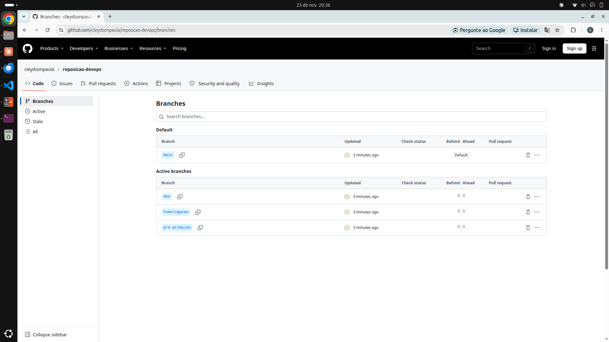

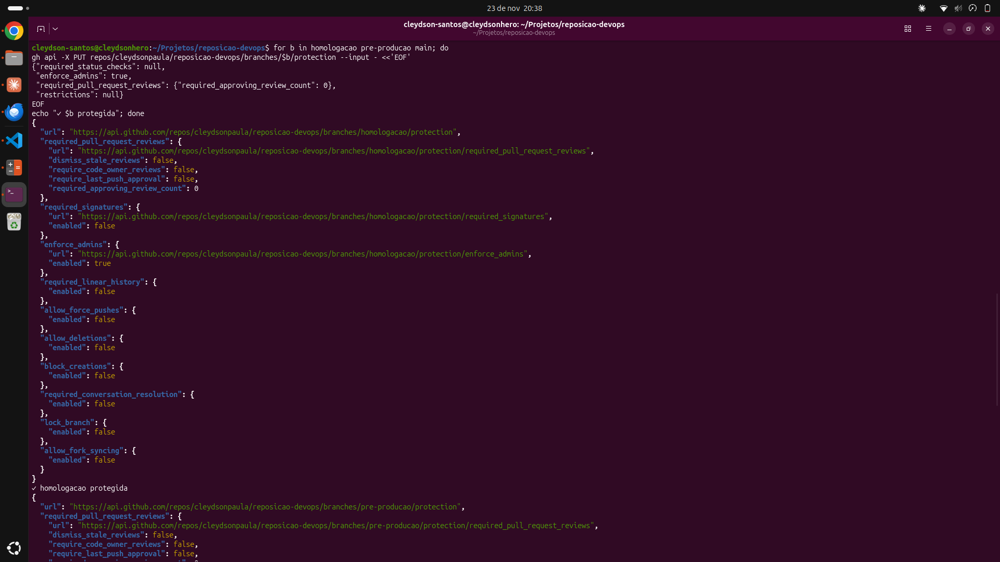


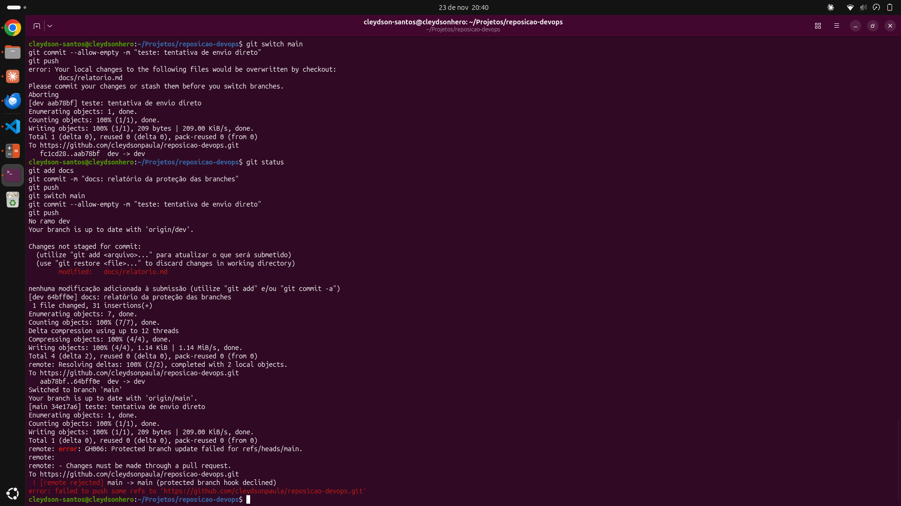

---

## Etapa 2 — Contêiner da aplicação

### O que foi feito

1. Escrito o `Dockerfile`, a "receita" que empacota a aplicação numa **imagem**.
2. Criado o `.dockerignore`, para que arquivos que não fazem parte da aplicação não entrem na imagem.
3. A conexão com o banco (`app/inc/conexao.php`) passou a ler os dados de **variáveis de ambiente**.
4. O `docker-compose.yml` passou a construir a imagem a partir do `Dockerfile`.
5. Construída a imagem, executados os contêineres (aplicação + banco) e testado o acesso pelo navegador.

### Dockerfile

```dockerfile
FROM php:8.3-apache                     # imagem oficial: PHP 8.3 com servidor Apache
RUN docker-php-ext-install pdo_mysql    # extensão que liga o PHP ao MySQL
COPY app/ /var/www/html/                # código da aplicação dentro da imagem
EXPOSE 80                               # a aplicação atende na porta 80
```

Antes, o contêiner usava a imagem pura do PHP e instalava a extensão do MySQL **toda vez que ligava**.
Agora a extensão e o código ficam **dentro da imagem**: o contêiner liga pronto e se comporta igual em
qualquer máquina — no computador, no Jenkins ou no Kubernetes.

O `.dockerignore` exclui da imagem a pasta `.git`, a documentação (`docs`) e os arquivos `.csv`.

### Configuração por variáveis de ambiente

A conexão estava escrita no código (`host=db`, usuário e senha fixos). Para que **a mesma imagem** sirva
aos quatro ambientes — cada um com seu banco e sua senha —, ela passou a ler as variáveis `DB_HOST`,
`DB_NAME`, `DB_USER` e `DB_PASS`:

```php
$host  = getenv('DB_HOST') ?: 'db';
$banco = getenv('DB_NAME') ?: 'simples';
$user  = getenv('DB_USER') ?: 'simples';
$senha = getenv('DB_PASS') ?: 'simples';
```

Esse princípio — a imagem é a mesma em todos os ambientes, o que muda é a configuração — é um dos fatores
do *Twelve-Factor App* e é o que permite promover exatamente o mesmo artefato de `dev` até `producao`.

### Comandos

```bash
docker build -t reposicao-devops:local .   # constrói a imagem a partir do Dockerfile
docker images reposicao-devops             # confere a imagem criada
docker compose up -d                       # liga aplicação e banco em segundo plano
docker compose ps                          # confere se os contêineres estão no ar
```

| Comando | Para que serve |
|---|---|
| `docker build -t nome:etiqueta .` | Lê o `Dockerfile` da pasta atual e gera a imagem com esse nome |
| `docker images` | Lista as imagens e o tamanho de cada uma |
| `docker compose up -d` | Cria a rede, o volume do banco e liga os contêineres descritos no `docker-compose.yml` |
| `docker compose ps` | Mostra os contêineres, o estado (`Up`) e as portas |

### Resultado

- Imagem `reposicao-devops:local` construída em 4 passos, com 176 MB de conteúdo próprio.
- Contêineres `devops-web` (aplicação, porta 8090) e `devops-db` (MySQL 8.0) no ar.
- Aplicação acessível em `http://localhost:8090`, com login funcionando (o login consulta o banco, o que
  confirma a conexão entre os dois contêineres).

### Observações

- A porta 8081, usada originalmente, já estava ocupada por outro sistema na máquina; a aplicação passou a
  usar a **8090**.
- O Docker mostrou o aviso `DEPRECATED: The legacy builder is deprecated`. Não é erro: indica que existe
  uma ferramenta de build mais nova (BuildKit/buildx). A construção funcionou normalmente.

### Evidências


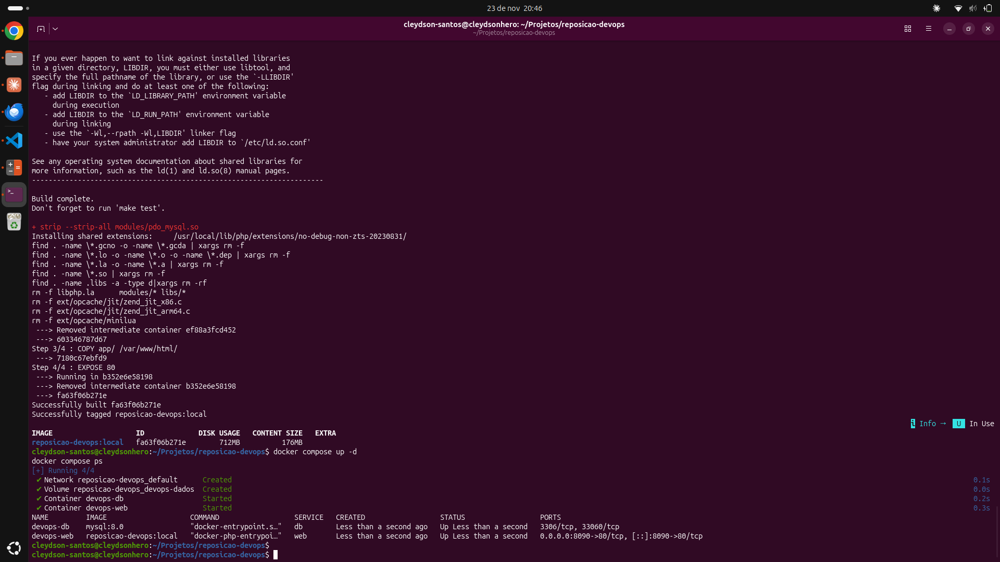

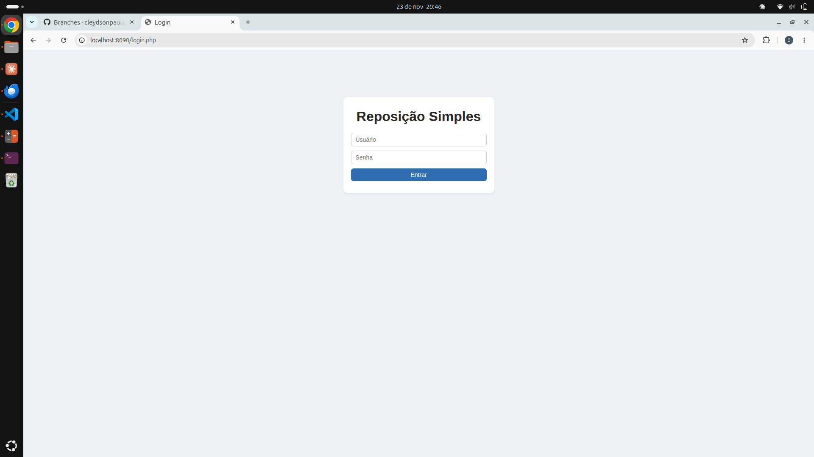


---

## Etapa 3 — Kubernetes

### O que foi feito

1. Instaladas as ferramentas `kubectl` (v1.37.2) e `kind` (v0.33.0).
2. Criado um cluster Kubernetes local com o **kind** (*Kubernetes IN Docker*), com portas abertas para o
   computador — uma por ambiente.
3. Escritos os manifestos (arquivos YAML) da aplicação e do banco, organizados em **base + overlays**
   com o Kustomize.
4. Criado o script `k8s/deploy.sh`, que publica a aplicação num ambiente — o mesmo que o Jenkins usará.
5. Publicada a aplicação nos quatro ambientes, cada um no seu *namespace*.

### Instalação das ferramentas

```bash
curl -LO "https://dl.k8s.io/release/$(curl -Ls https://dl.k8s.io/release/stable.txt)/bin/linux/amd64/kubectl"
KIND_VER=$(curl -s https://api.github.com/repos/kubernetes-sigs/kind/releases/latest | grep -m1 tag_name | cut -d'"' -f4)
curl -Lo kind "https://kind.sigs.k8s.io/dl/${KIND_VER}/kind-linux-amd64"
sudo install -m 0755 kubectl kind /usr/local/bin/
```

O `kubectl` é o cliente que envia ordens ao Kubernetes; o `kind` cria um cluster Kubernetes completo dentro
de um contêiner Docker — leve, ideal para estudo e para testes de pipelines.

### O cluster

O arquivo `k8s/kind-config.yaml` descreve o cluster `devops`: um nó (*control-plane*) e quatro portas
mapeadas do nó para o computador.

| Ambiente | NodePort (dentro do cluster) | Endereço no navegador |
|---|---|---|
| dev | 30081 | http://localhost:8101 |
| homologacao | 30082 | http://localhost:8102 |
| pre-producao | 30083 | http://localhost:8103 |
| producao | 30084 | http://localhost:8104 |

```bash
kind create cluster --config k8s/kind-config.yaml
kubectl get nodes
```

Logo após a criação o nó aparece como `NotReady` (com 4 s de vida, a rede interna ainda está subindo);
cerca de 40 s depois passa a `Ready`.

### Organização dos manifestos (Kustomize)

```
k8s/
├─ kind-config.yaml        configuração do cluster
├─ base/                   o que é igual nos quatro ambientes
│   ├─ mysql.yaml          banco: disco, contêiner e Service "mysql"
│   ├─ app.yaml            aplicação: contêiner(es) e Service NodePort
│   └─ kustomization.yaml
├─ overlays/               o que muda em cada ambiente
│   ├─ dev/            namespace dev,          porta 30081, 1 réplica
│   ├─ homologacao/    namespace homologacao,  porta 30082, 1 réplica
│   ├─ pre-producao/   namespace pre-producao, porta 30083, 2 réplicas
│   └─ producao/       namespace producao,     porta 30084, 2 réplicas
└─ deploy.sh               publica a aplicação num ambiente
```

A **base** descreve a aplicação uma única vez; cada **overlay** aplica só as diferenças do seu ambiente.
Assim não há quatro cópias dos mesmos arquivos para manter. Pré-produção e produção rodam com **duas
réplicas** da aplicação, como em um ambiente real com alta disponibilidade.

### Recursos do Kubernetes utilizados

| Recurso | Uso neste projeto |
|---|---|
| **Namespace** | Separa os quatro ambientes dentro do mesmo cluster |
| **Deployment** | Mantém os contêineres rodando (recria o que cair) e troca a versão sem tirar do ar |
| **Service** | Endereço fixo: a aplicação encontra o banco pelo nome `mysql`; o NodePort publica a aplicação |
| **PersistentVolumeClaim** | Disco do banco — os dados sobrevivem a reinícios do contêiner |
| **Secret** | Senhas do banco, sorteadas por ambiente e **nunca gravadas no repositório** |
| **ConfigMap** | Guarda o `db/init.sql`, que cria as tabelas na primeira subida do banco |
| **Probes** | *readiness*: só envia visitas quando a aplicação responde; *liveness*: reinicia se ela travar |

Duas decisões merecem nota:

- **Banco com estratégia `Recreate`:** ao atualizar, o contêiner antigo do banco é desligado antes de o
  novo ligar, porque os dois não podem usar o mesmo disco ao mesmo tempo.
- **`sessionAffinity: ClientIP` no Service da aplicação:** o login é guardado na sessão de uma réplica.
  Com duas réplicas, o visitante precisa voltar sempre à mesma, senão perderia o login a cada página.

### Script de publicação

`k8s/deploy.sh <ambiente> [etiqueta-da-imagem]` executa, em ordem:

1. cria o *namespace* do ambiente, se ainda não existir;
2. grava o `init.sql` num ConfigMap;
3. cria o Secret com senhas aleatórias (só na primeira vez — depois, mantém as existentes);
4. aplica o overlay do ambiente com a etiqueta da imagem desta versão;
5. espera o banco e a aplicação ficarem prontos (`kubectl rollout status`).

Todos os passos são **idempotentes**: rodar o script de novo não duplica nada, apenas atualiza.

### Publicação nos quatro ambientes

O cluster não enxerga as imagens do Docker do computador, por isso a imagem é carregada nele antes:

```bash
kind load docker-image reposicao-devops:local --name devops
k8s/deploy.sh dev
k8s/deploy.sh homologacao
k8s/deploy.sh pre-producao
k8s/deploy.sh producao
kubectl get pods -A
```

Resultado: **10 pods em execução** — em cada ambiente um banco, e 1 (dev, homologação) ou 2 (pré-produção,
produção) réplicas da aplicação —, todos `1/1 Running` e sem reinícios. Na listagem também aparecem os
componentes internos do Kubernetes (namespace `kube-system`: etcd, apiserver, scheduler,
controller-manager).

### Evidências

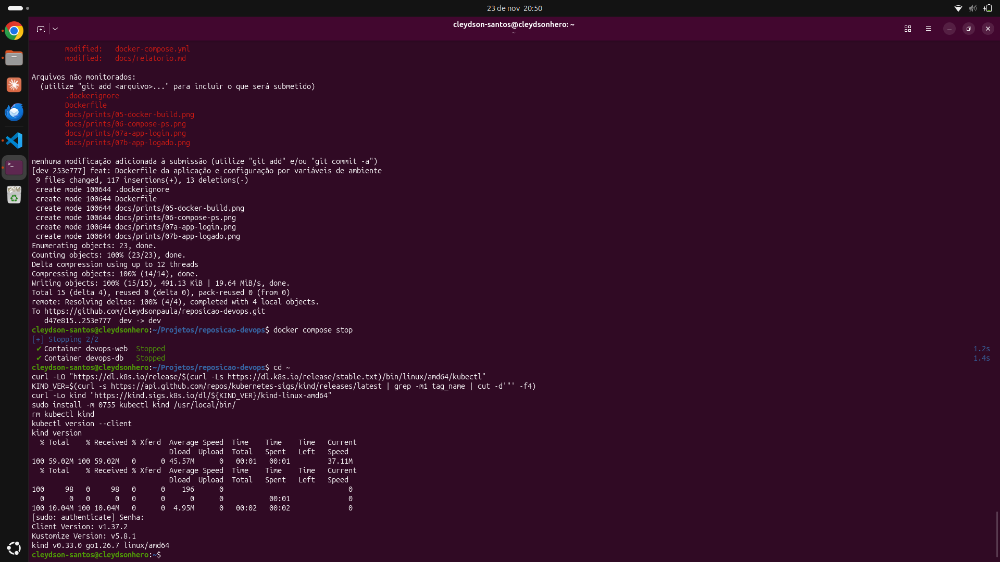

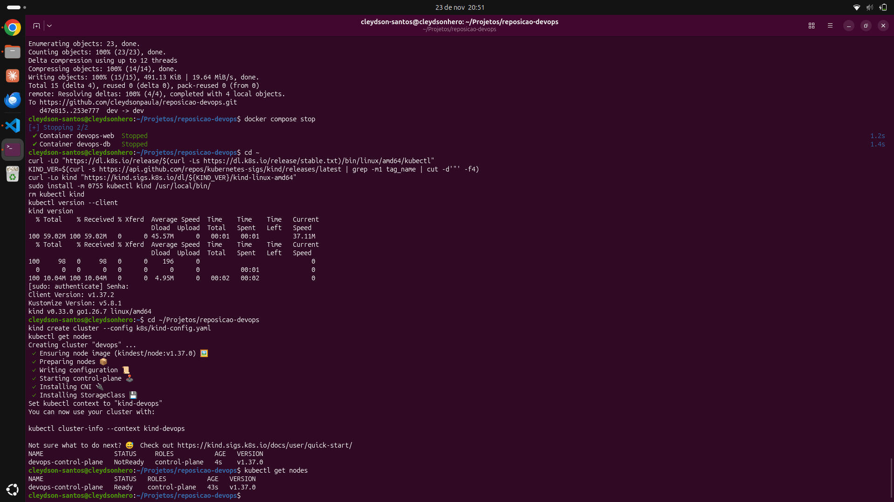

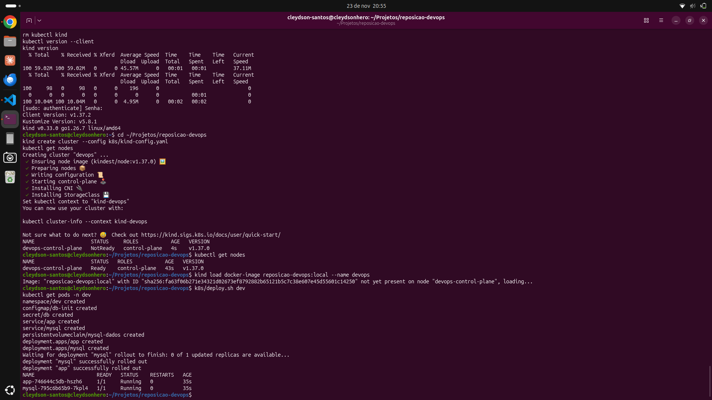

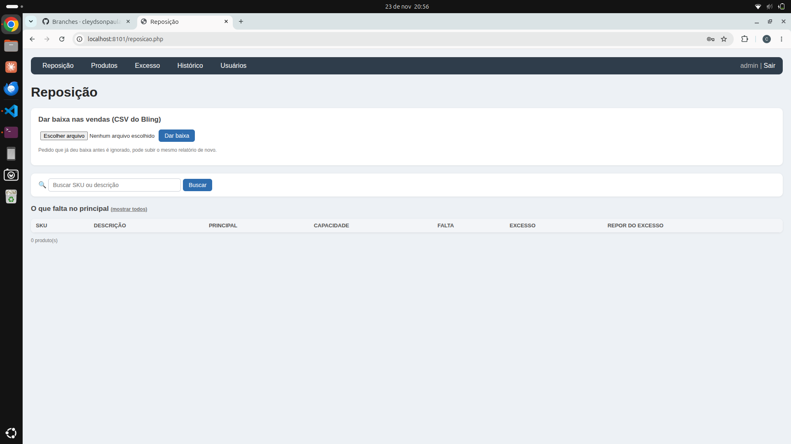

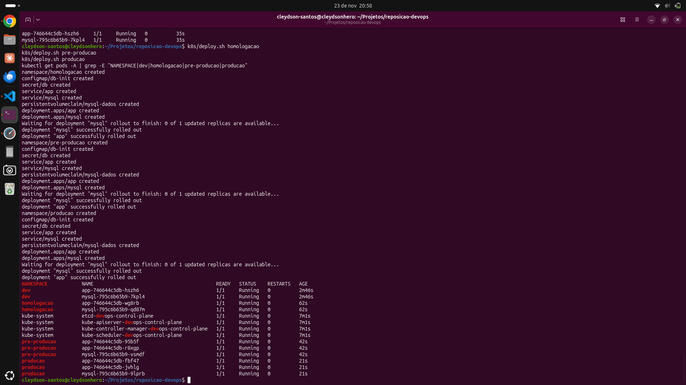

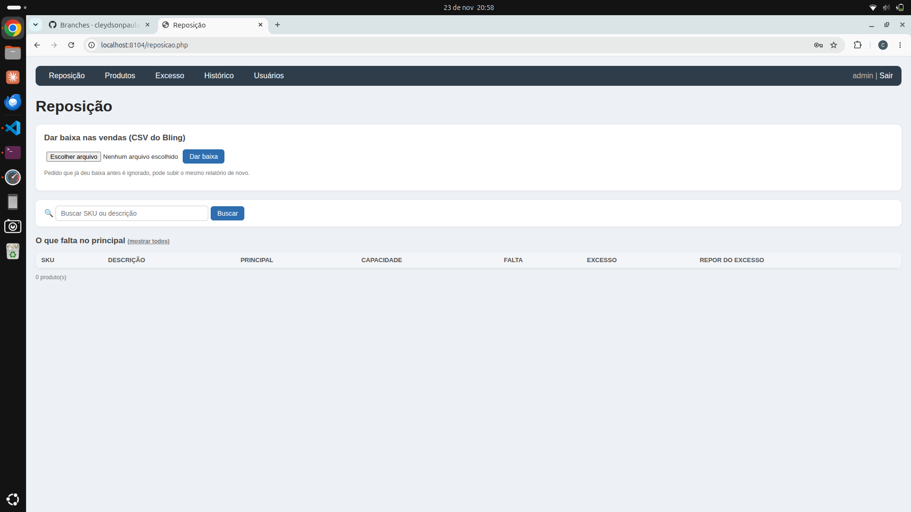

---

## Etapa 4 — Jenkins e Multibranch Pipeline

### O que foi feito

1. Escrito o `Jenkinsfile` — o pipeline, **um único arquivo para as quatro branches**.
2. Criada a página de saúde `app/saude.php` (responde sem depender do banco), usada no teste do pipeline
   e na *livenessProbe* do Kubernetes.
3. Construída uma imagem própria do Jenkins com Docker (cliente), `kubectl`, `kind` e os plugins.
4. Ligado o Jenkins em contêiner, com acesso ao Docker do computador e ao cluster.
5. Criado o job **Multibranch Pipeline** apontando para o repositório do GitHub.
6. Promovido o código pelos quatro ambientes por *pull request*, com o Jenkins publicando cada um
   automaticamente e pedindo **aprovação manual antes da produção**.

### Arquitetura

```
GitHub ──(varredura a cada 1 min)──► Jenkins (contêiner, porta 8095)
                                       │  docker build / docker run   ──► Docker do computador (socket)
                                       │  kind load                   ──► nó do cluster
                                       └  kubectl (k8s/deploy.sh)     ──► API do Kubernetes (rede "kind")
```

O Jenkins roda no computador local, que **não é alcançável pela internet**; por isso o GitHub não consegue
avisá-lo de mudanças (*webhook*). A solução adotada foi a **varredura periódica**: a cada minuto o Jenkins
consulta o repositório e dispara o pipeline das branches que mudaram.

### O pipeline (`Jenkinsfile`)

| Estágio | O que faz | Em quais branches |
|---|---|---|
| Ambiente | Descobre o ambiente pela branch (`main` → `producao`) | todas |
| Build da imagem | `docker build`, com a etiqueta `<branch>-<número da execução>` | todas |
| Testes | 1) `php -l` em todos os arquivos PHP, **dentro da imagem gerada**; 2) teste de fumaça: liga o contêiner e espera o `saude.php` responder | todas |
| Carregar no cluster | `kind load docker-image` | dev, homologacao, pre-producao, main |
| Aprovação | Para e pergunta "Publicar em PRODUÇÃO?" (limite de 30 min) | **só `main`** |
| Publicar | `k8s/deploy.sh <ambiente> <etiqueta>` e lista os pods | dev, homologacao, pre-producao, main |

Se qualquer estágio falhar, os seguintes não rodam e **nada é publicado**. Outras branches (por exemplo,
uma branch de funcionalidade) apenas constroem e testam.

A etiqueta da imagem (`dev-1`, `homologacao-1`, `main-1`…) identifica de qual branch e de qual execução
veio cada versão — é possível saber exatamente o que está rodando em cada ambiente.

### Imagem e execução do Jenkins

```dockerfile
FROM jenkins/jenkins:lts-jdk21
USER root
COPY --from=docker:27-cli /usr/local/bin/docker /usr/local/bin/docker
RUN curl -fsSLo /usr/local/bin/kubectl https://dl.k8s.io/release/v1.37.2/bin/linux/amd64/kubectl \
 && curl -fsSLo /usr/local/bin/kind https://kind.sigs.k8s.io/dl/v0.33.0/kind-linux-amd64 \
 && chmod +x /usr/local/bin/kubectl /usr/local/bin/kind
USER jenkins
RUN jenkins-plugin-cli --plugins workflow-aggregator workflow-multibranch git pipeline-stage-view \
    timestamper ws-cleanup credentials-binding
```

```bash
kind get kubeconfig --internal --name devops > ~/.kube/kind-devops-interno   # acesso ao cluster
docker build -t reposicao-jenkins jenkins/
docker run -d --name jenkins --network kind -p 8095:8080 \
  -v jenkins_home:/var/jenkins_home \
  -v /var/run/docker.sock:/var/run/docker.sock \
  -v $HOME/.kube/kind-devops-interno:/kube/config:ro \
  --group-add $(stat -c %g /var/run/docker.sock) \
  --restart unless-stopped reposicao-jenkins
```

| Opção | Por quê |
|---|---|
| `--network kind` | O Jenkins fica na mesma rede do cluster e alcança a API em `devops-control-plane:6443` |
| `-v /var/run/docker.sock` | O Jenkins usa o Docker do computador para construir e testar as imagens |
| `kubeconfig --internal` | Gera o acesso ao cluster com o nome do nó (e não `127.0.0.1`), que funciona de dentro de outro contêiner; o arquivo tem a chave do cluster e fica fora do repositório |
| `--group-add` | Dá ao usuário do Jenkins permissão de usar o Docker, sem rodar o Jenkins como root |
| `-v jenkins_home` | Configuração e histórico sobrevivem à recriação do contêiner |

### Configuração do Multibranch Pipeline

- **Branch Sources → Git**, repositório `https://github.com/cleydsonpaula/reposicao-devops.git`, sem
  credencial (repositório público), comportamento *Discover branches*.
- **Build Configuration:** *by Jenkinsfile*.
- **Scan Multibranch Pipeline Triggers:** *Periodically if not otherwise run*, a cada **1 minuto**.

Na primeira varredura, só a `dev` tinha `Jenkinsfile`; o Jenkins criou o pipeline apenas para ela:

```
Checking branch main          ‘Jenkinsfile’ not found   Does not meet criteria
Checking branch homologacao   ‘Jenkinsfile’ not found   Does not meet criteria
Checking branch pre-producao  ‘Jenkinsfile’ not found   Does not meet criteria
Checking branch dev           ‘Jenkinsfile’ found       Met criteria
Scheduled build for branch: dev
```

### Promoção pelos ambientes

A cada *pull request* aceito, a branch de destino passa a ter o `Jenkinsfile`, e em até um minuto o
Jenkins cria o pipeline dela e publica no ambiente correspondente — **sem nenhuma ação no Jenkins**.

```bash
gh pr create --base homologacao  --head dev          --title "Promoção: dev → homologação"            # PR #1
gh pr merge 1 --merge
gh pr create --base pre-producao --head homologacao  --title "Promoção: homologação → pré-produção"   # PR #2
gh pr merge 2 --merge
gh pr create --base main         --head pre-producao --title "Promoção: pré-produção → produção"      # PR #3
gh pr merge 3 --merge
```

Na `main`, o pipeline construiu, testou e carregou a imagem, e então **parou no estágio Aprovação**,
aguardando o clique em "Publicar". Só depois disso a versão foi para produção (o Jenkins registra
"paused for 1min 35s").

### Resultado

| Ambiente | Versão em execução | Réplicas | Publicada por |
|---|---|---|---|
| dev | `reposicao-devops:dev-1` | 1/1 | Jenkins, automático |
| homologacao | `reposicao-devops:homologacao-1` | 1/1 | Jenkins, após PR #1 |
| pre-producao | `reposicao-devops:pre-producao-1` | 2/2 | Jenkins, após PR #2 |
| producao | `reposicao-devops:main-1` | 2/2 | Jenkins, após PR #3 **e aprovação manual** |

Cada execução levou de 20 a 30 segundos (sem contar a espera pela aprovação).

### Entrega contínua: um push dispara a esteira

Para confirmar o ciclo completo, o próprio commit deste relatório foi enviado à `dev` com `git push`. Sem
nenhuma ação no Jenkins, a varredura detectou a mudança e rodou a execução **dev #2**, que construiu,
testou e publicou a nova versão (`reposicao-devops:dev-2`) no ambiente dev. No Stage View, a #2 aparece
com "1 commit" — o Jenkins registra qual mudança disparou cada execução.

### Problemas encontrados

- **Fonte "GitHub" × "Git".** No Multibranch, a primeira escolha foi a fonte *GitHub*, que usa a API do
  GitHub. Sem credencial, a API limita a 60 consultas por hora — com varredura a cada minuto o Jenkins
  ficaria bloqueado. Além disso, a opção padrão *"Exclude branches that are also filed as PRs"* esconde a
  branch enquanto houver um PR aberto. A fonte foi trocada por *Git*, que lê o repositório como um
  `git clone`, sem limite e sem credencial.
- **`gh pr merge` sem número.** Sem o número, o comando age sobre o PR da branch atual (`dev`), que já tinha
  sido aceito, e ofereceu apagar a branch local. A resposta foi "não", e o PR foi aceito pelo número
  (`gh pr merge 2 --merge`). **Lição:** sempre informar o número do PR.

### Melhorias possíveis

- **Webhook** em vez de varredura, com o Jenkins publicado na internet (ou por um túnel).
- **Status do pipeline no GitHub** e regra de proteção exigindo o pipeline verde antes do merge — exige a
  fonte *GitHub* com um token de acesso.
- **Registro de imagens** (Docker Hub, GHCR) em vez de `kind load`, como seria num cluster de verdade.

### Evidências

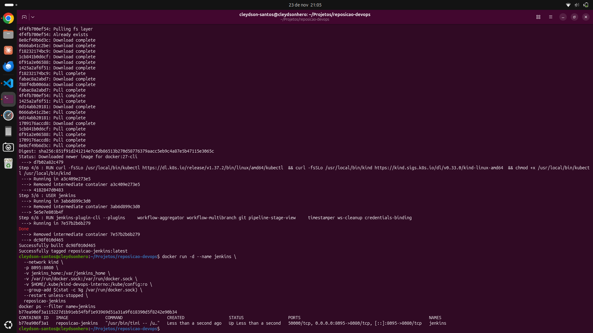

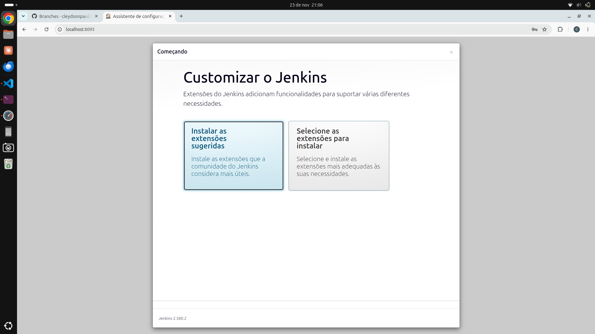

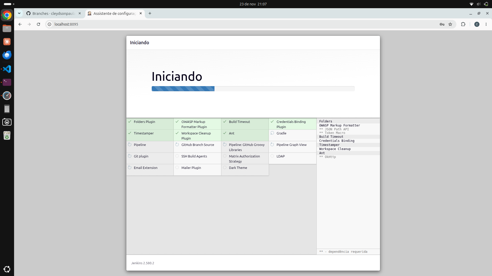

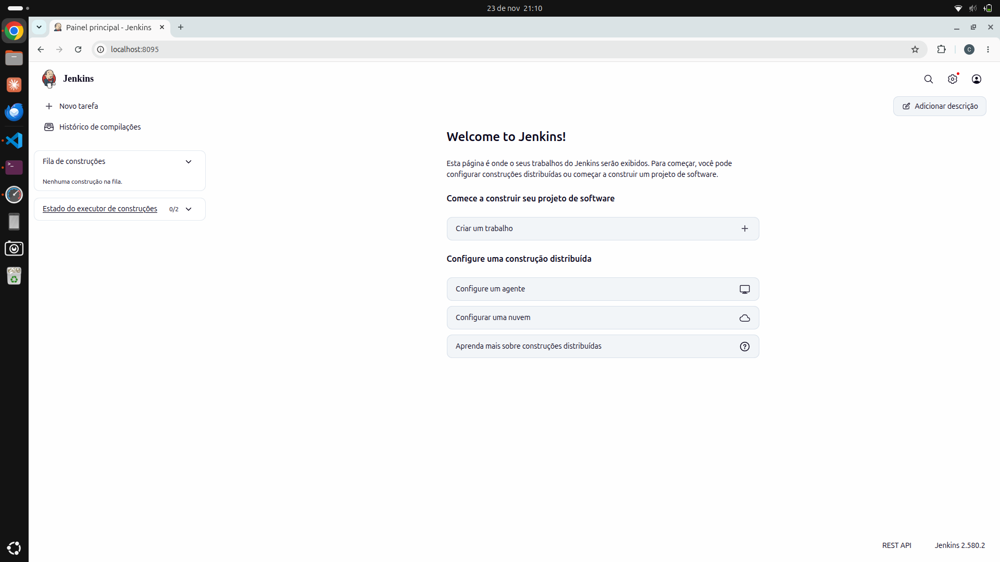

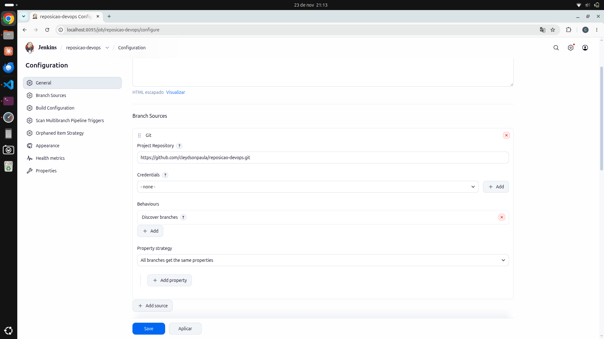

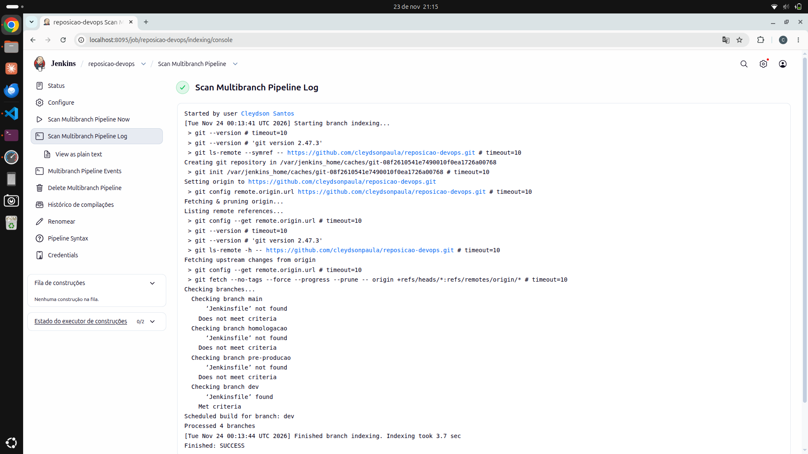

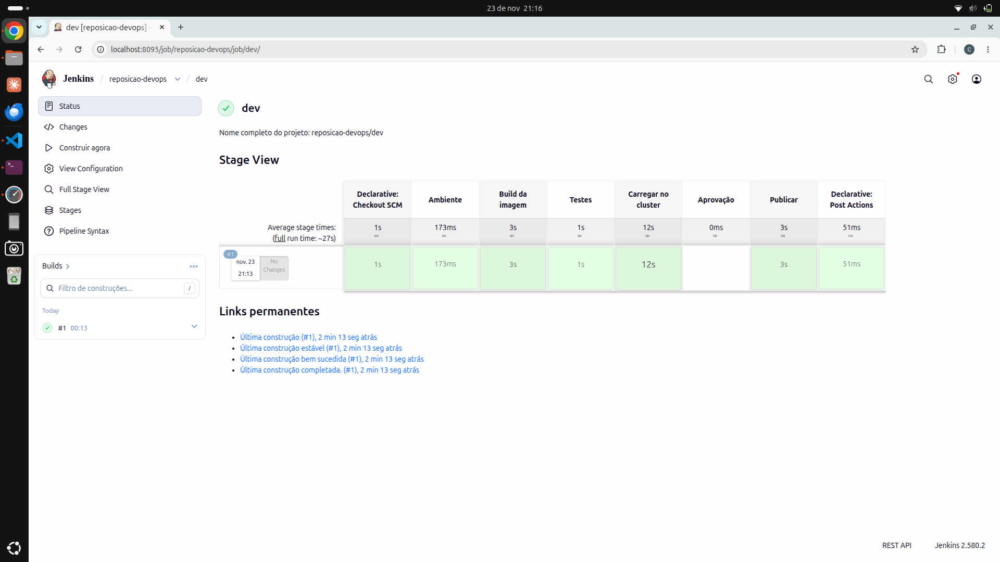

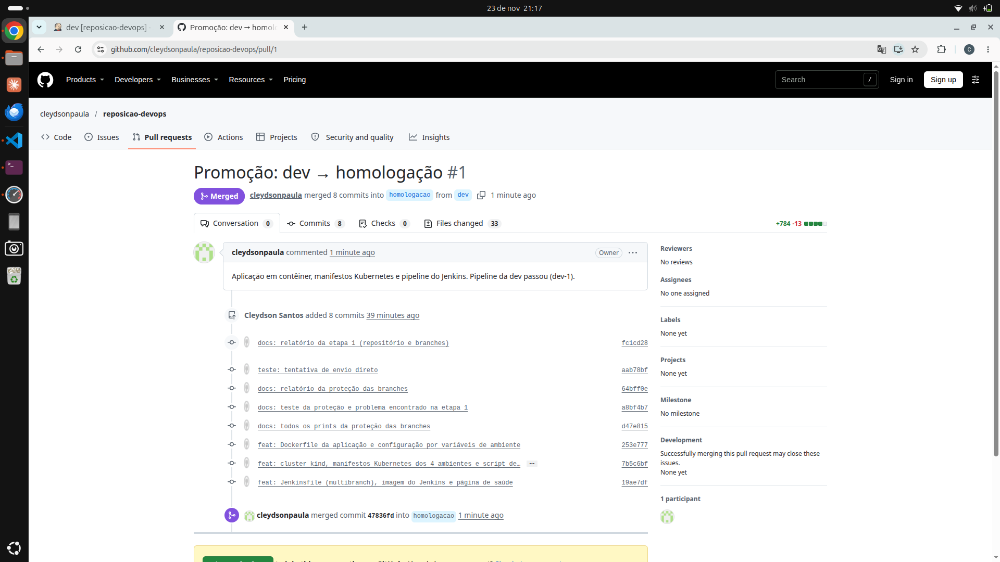

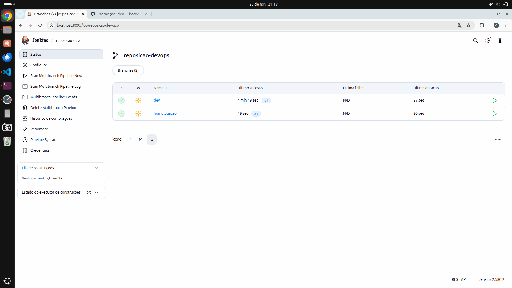

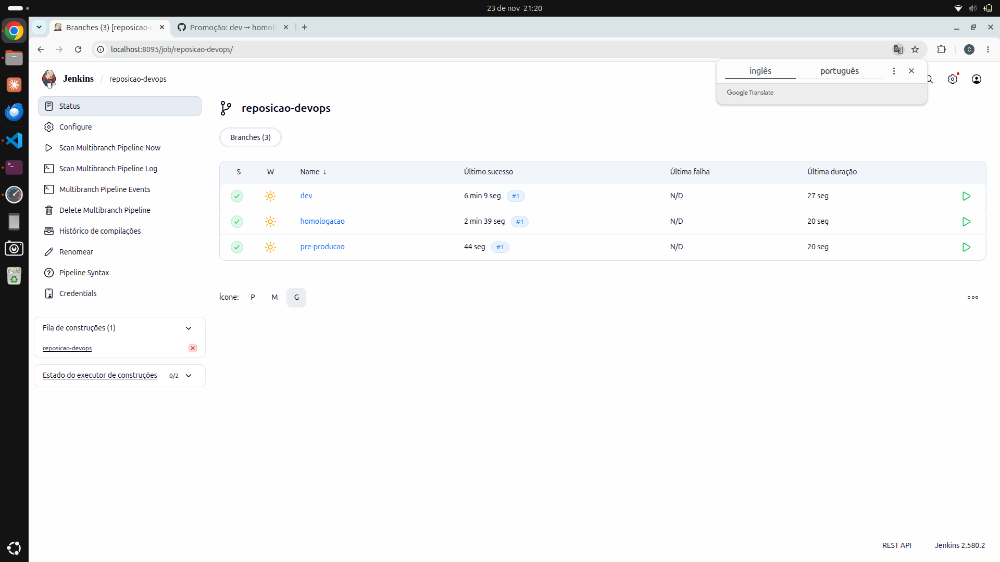

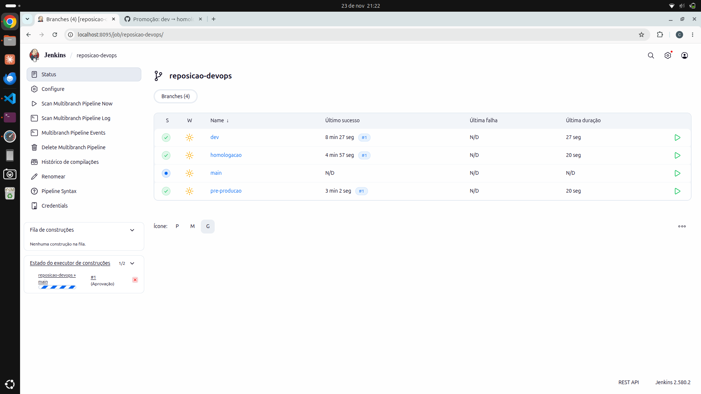

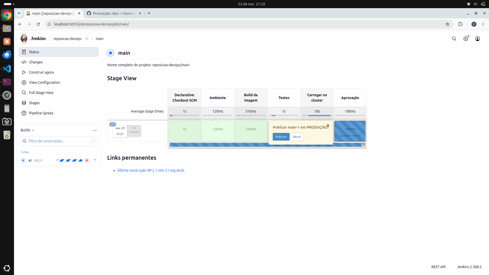

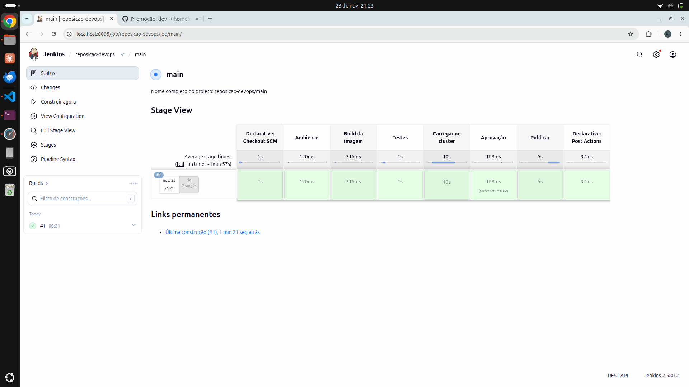

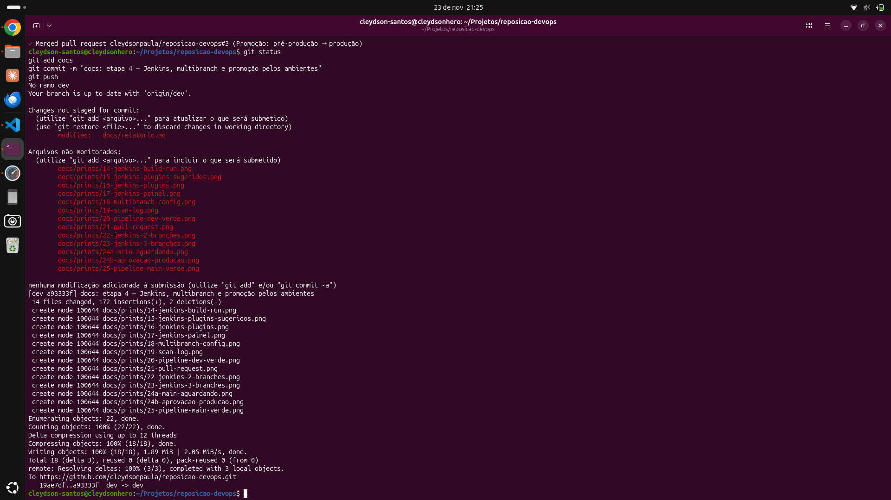

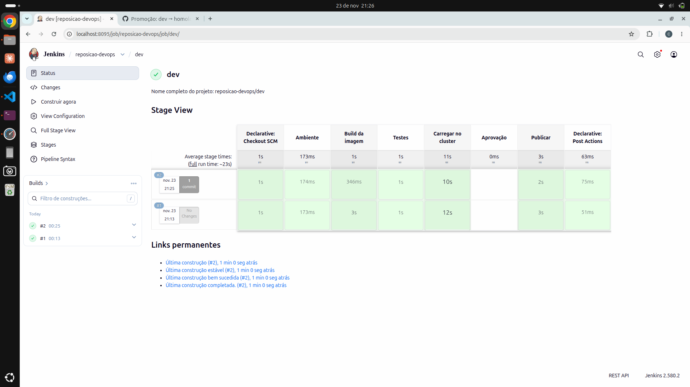

---

## Etapa 5 — Logs centralizados: Elasticsearch, Fluent Bit e Kibana

### O que foi feito

1. Criado o namespace `logs` com a pilha **EFK**: Elasticsearch (armazena e indexa), Fluent Bit (coleta) e
   Kibana (pesquisa e visualização).
2. Configurado o Fluent Bit para ler os logs de **todos os contêineres** do cluster e anotar em cada linha
   de qual namespace, pod e contêiner ela veio.
3. Criado no Kibana o *Data View* `logs-*`.
4. Gerado tráfego de teste (acessos válidos e acessos a uma página inexistente) e pesquisados os logs —
   inclusive **só os erros da produção**.

### Arquitetura

```
Cluster kind
 ├─ dev / homologacao / pre-producao / producao
 │     └─ cada contêiner escreve seu log na saída padrão (cada acesso ao Apache vira uma linha)
 │        o Kubernetes grava essas linhas em /var/log/containers/ no nó
 └─ namespace logs
       ├─ Fluent Bit (DaemonSet)  lê /var/log/containers/*.log, acrescenta os metadados do Kubernetes
       │                          e envia ao Elasticsearch
       ├─ Elasticsearch           guarda num índice por dia (logs-AAAA.MM.DD)
       └─ Kibana                  interface web (acesso por kubectl port-forward)
```

### Manifestos (`k8s/logs/`)

| Arquivo | Conteúdo |
|---|---|
| `elasticsearch.yaml` | Deployment de um nó (`discovery.type=single-node`), memória da JVM limitada a 512 MB, disco de 2 GB (PVC) e Service na porta 9200 |
| `kibana.yaml` | Deployment e Service na porta 5601, apontando para `http://elasticsearch:9200` |
| `fluent-bit.yaml` | **DaemonSet** (uma cópia por nó, lendo `/var/log` do nó), **ConfigMap** com a configuração e **RBAC** de só leitura (ServiceAccount + ClusterRole + ClusterRoleBinding) para consultar pods e namespaces |
| `kustomization.yaml` | Agrupa tudo no namespace `logs` |

A configuração do Fluent Bit tem três partes:

```ini
[INPUT]                          # entrada: os arquivos de log dos contêineres
    Name              tail
    Path              /var/log/containers/*.log
    Exclude_Path      /var/log/containers/*_logs_*.log   # ignora a própria pilha de logs
    multiline.parser  docker, cri
    Tag               kube.*

[FILTER]                         # anota namespace, pod e contêiner em cada linha
    Name   kubernetes
    Match  kube.*

[OUTPUT]                         # envia ao Elasticsearch, um índice por dia
    Name             es
    Host             elasticsearch
    Logstash_Format  On
    Logstash_Prefix  logs
```

O filtro `kubernetes` é o que torna possível separar os ambientes: cada linha ganha o campo
`kubernetes.namespace_name` (`dev`, `homologacao`, `pre-producao`, `producao`).

### Comandos

```bash
kubectl apply -k k8s/logs                          # cria a pilha inteira
kubectl -n logs get pods -w                        # acompanha até os 3 pods ficarem 1/1 Running
kubectl -n logs port-forward svc/kibana 5601:5601  # túnel até o Kibana: http://localhost:5601
```

As quatro portas do cluster já estavam reservadas para os ambientes; por isso o Kibana é acessado por um
túnel do `kubectl` (`port-forward`), sem abrir uma porta nova no cluster.

### Tráfego de teste e pesquisa

```bash
for i in $(seq 1 20); do
  curl -s -o /dev/null http://localhost:8104/login.php                    # produção, acesso válido
  curl -s -o /dev/null http://localhost:8104/pagina-que-nao-existe.php    # produção, erro 404
  curl -s -o /dev/null http://localhost:8101/login.php                    # dev, acesso válido
done
```

No Kibana (Discover), a busca em **KQL** (*Kibana Query Language*)

```
kubernetes.namespace_name : "producao" and log : "404"
```

retornou exatamente os **20 acessos com erro da produção**, todos às 21:38, com a linha completa do
Apache (`GET /pagina-que-nao-existe.php HTTP/1.1" 404`).

A distribuição dos logs por ambiente (1.590 registros em 15 minutos):

| Ambiente | Participação |
|---|---|
| producao | 32,1% |
| pre-producao | 28,2% |
| dev | 15,4% |
| homologacao | 14,2% |
| kube-system | 10,1% |

Produção e pré-produção geram mais registros porque rodam **duas réplicas** — cada réplica registra as
verificações de saúde (*probes*) do Kubernetes, feitas a cada poucos segundos —, e a produção recebeu
ainda o tráfego de teste.

### Observações

- **Segurança desligada de propósito.** O Elasticsearch roda sem senha e sem HTTPS
  (`xpack.security.enabled=false`) e o Kibana avisa "Your data is not secure". Em laboratório isso é
  aceitável porque o Elasticsearch só é acessível de dentro do cluster; em produção a segurança ficaria
  ligada, com usuário próprio para o Fluent Bit e o Kibana.
- **Data do índice em UTC.** O índice criado foi `logs-2026.11.24` às 21h30 de 23/11: o Elasticsearch usa
  UTC (3 horas à frente do horário de Brasília). O Kibana converte e mostra no horário local.
- **Mesma imagem em todos os ambientes.** Nos logs, o campo `kubernetes.container_image` dos pods de
  produção mostra `reposicao-devops:dev-1`, e não `main-1`. Como o código da aplicação foi o mesmo de `dev`
  até `main` (a pasta `docs/` fica fora da imagem pelo `.dockerignore`), as etiquetas `dev-1`,
  `homologacao-1`, `pre-producao-1` e `main-1` apontam para **a mesma imagem, com o mesmo conteúdo** — e o
  cluster exibe a primeira etiqueta que recebeu. É um exemplo de *build* reprodutível: o mesmo código gera
  a mesma imagem.

### Evidências

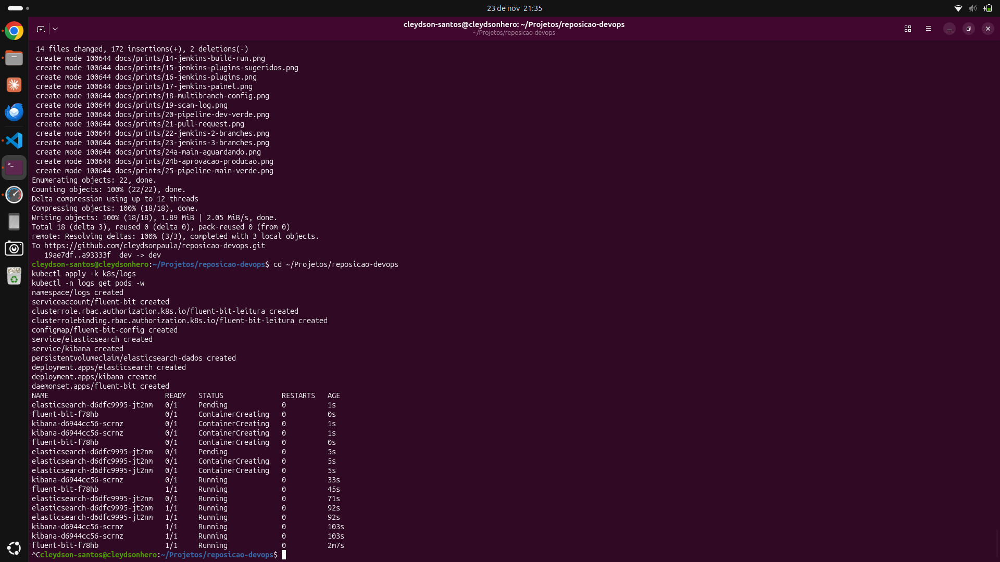

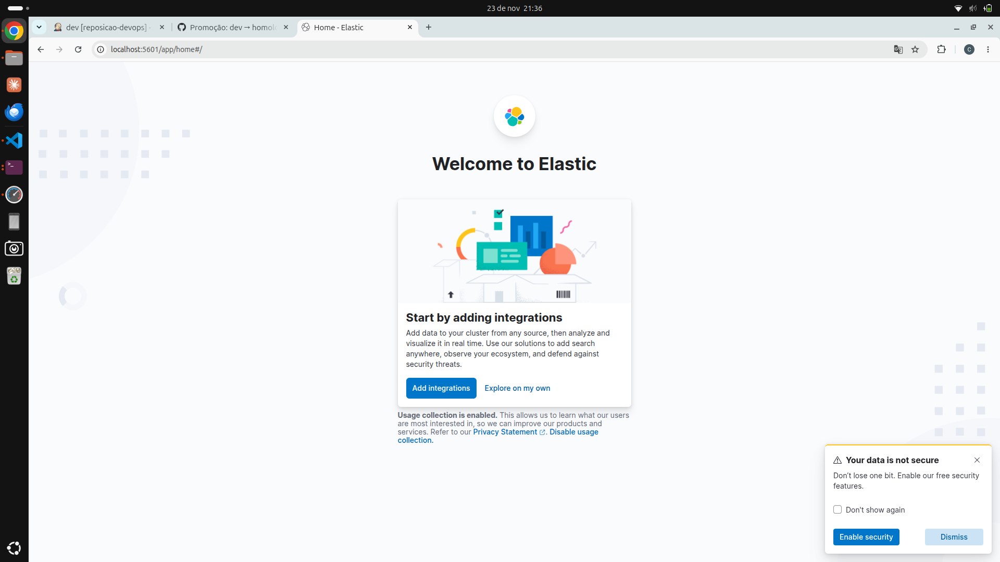

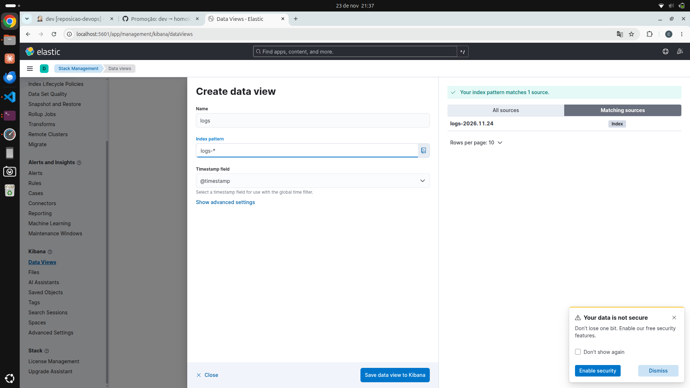

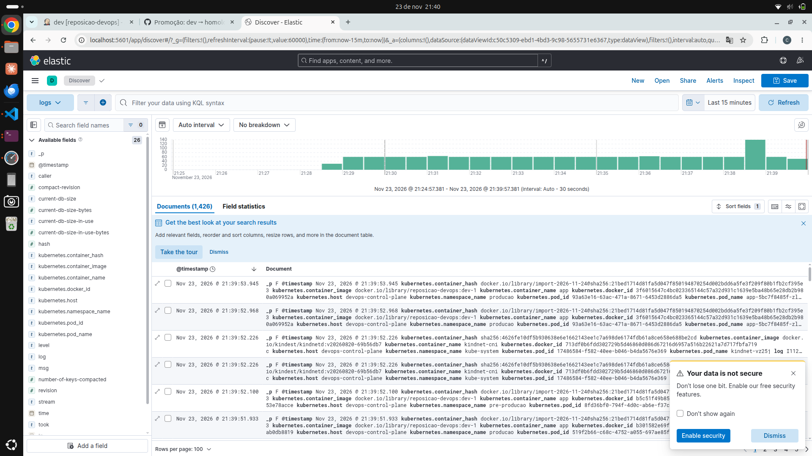

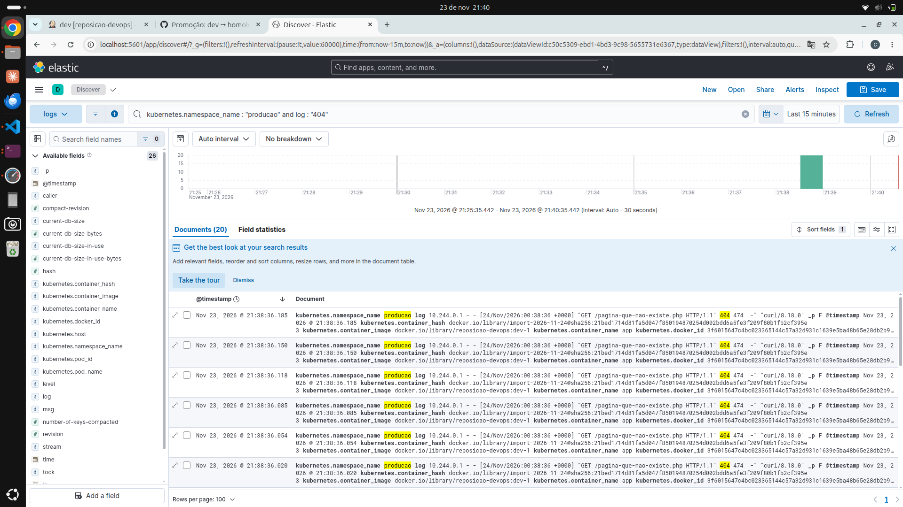

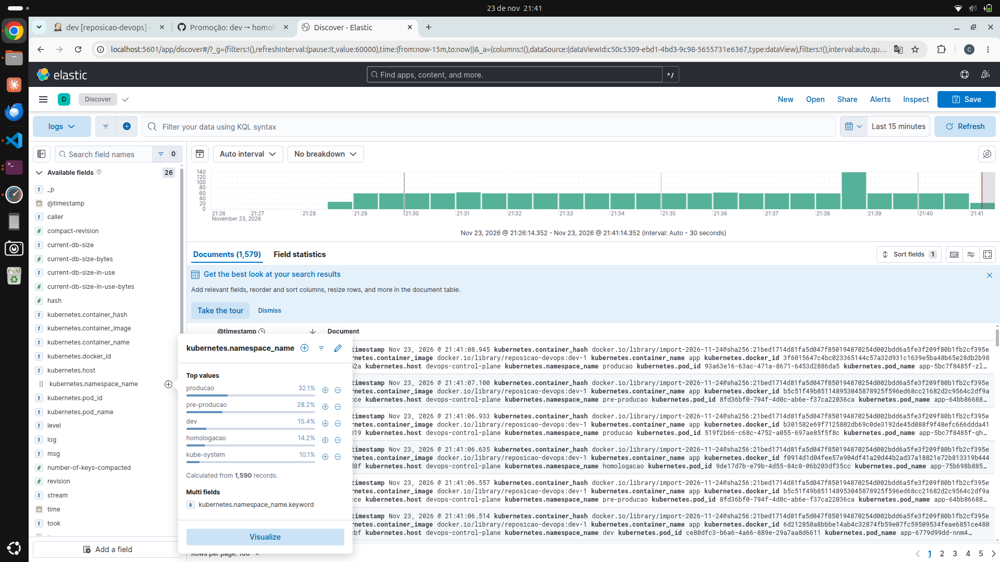

---

## Etapa 6 — Promoção final

Com todas as etapas prontas na `dev`, a versão completa — aplicação, manifestos, pipeline, pilha de logs e
este relatório — foi promovida novamente pelos quatro ambientes, desta vez com mudanças reais em cada
*pull request*: `dev` → `homologacao` → `pre-producao` → `main`, com a aprovação manual no Jenkins antes
da produção. Assim a branch `main`, a primeira que se vê no GitHub, passa a conter o trabalho completo.

*(evidências ao final desta seção)*

---

## Como reproduzir

Pré-requisitos: Linux com Docker, `git` e `gh` (GitHub CLI) autenticado; cerca de 6 GB de memória livre.

```bash
# 1. código
git clone https://github.com/cleydsonpaula/reposicao-devops.git && cd reposicao-devops

# 2. (opcional) a aplicação sozinha, com Docker Compose — http://localhost:8090 (admin / admin)
docker compose up -d --build

# 3. ferramentas do Kubernetes
curl -LO "https://dl.k8s.io/release/$(curl -Ls https://dl.k8s.io/release/stable.txt)/bin/linux/amd64/kubectl"
curl -Lo kind https://kind.sigs.k8s.io/dl/v0.33.0/kind-linux-amd64
sudo install -m 0755 kubectl kind /usr/local/bin/ && rm kubectl kind

# 4. cluster e os quatro ambientes (portas 8101 a 8104)
kind create cluster --config k8s/kind-config.yaml
docker build -t reposicao-devops:local .
kind load docker-image reposicao-devops:local --name devops
for amb in dev homologacao pre-producao producao; do k8s/deploy.sh $amb; done

# 5. pilha de logs — Kibana em http://localhost:5601
kubectl apply -k k8s/logs
kubectl -n logs port-forward svc/kibana 5601:5601

# 6. Jenkins — http://localhost:8095
kind get kubeconfig --internal --name devops > ~/.kube/kind-devops-interno
docker build -t reposicao-jenkins jenkins/
docker run -d --name jenkins --network kind -p 8095:8080 \
  -v jenkins_home:/var/jenkins_home \
  -v /var/run/docker.sock:/var/run/docker.sock \
  -v $HOME/.kube/kind-devops-interno:/kube/config:ro \
  --group-add $(stat -c %g /var/run/docker.sock) \
  --restart unless-stopped reposicao-jenkins
docker exec jenkins cat /var/jenkins_home/secrets/initialAdminPassword   # senha inicial
```

No Jenkins: instalar as extensões sugeridas, criar o usuário administrador e um **Multibranch Pipeline**
com fonte **Git** apontando para o repositório, *Script Path* `Jenkinsfile` e varredura periódica de
1 minuto. A partir daí, cada `git push` numa das quatro branches publica no ambiente correspondente.

| Serviço | Endereço |
|---|---|
| dev / homologação / pré-produção / produção | http://localhost:8101 · 8102 · 8103 · 8104 |
| Jenkins | http://localhost:8095 |
| Kibana | http://localhost:5601 (com o `port-forward` aberto) |

Para desligar tudo e liberar a memória: `docker stop jenkins devops-control-plane`
(religar: `docker start devops-control-plane jenkins`).

---

## Conclusão

O trabalho resultou numa esteira completa e funcional: uma alteração enviada ao GitHub é construída,
testada e publicada automaticamente, ambiente por ambiente, e só chega à produção depois de passar pelos
outros três e de uma aprovação explícita. O mesmo artefato — a imagem Docker — é promovido de `dev` até
`producao`; o que muda entre os ambientes é apenas a configuração (namespace, porta, número de réplicas,
senhas), o que dá confiança de que o que foi testado é exatamente o que vai ao ar. Com os logs
centralizados, um problema em produção pode ser localizado em segundos, filtrando por ambiente e por
tipo de erro.

**Principais aprendizados:**

- **Git como fonte da verdade:** branches protegidas e *pull requests* garantem a ordem de promoção — nem
  o dono do repositório consegue enviar direto à `main`.
- **Contêineres e configuração por ambiente:** a mesma imagem serve aos quatro ambientes porque a
  aplicação lê a configuração de variáveis de ambiente, e as senhas ficam em *Secrets*, fora do código.
- **Kubernetes declarativo:** com Kustomize, a descrição comum fica na base e cada ambiente declara só o
  que muda; o cluster mantém o estado desejado (réplicas, reinício de contêineres, atualização sem parada).
- **Pipeline como código:** o `Jenkinsfile` versionado junto com a aplicação descreve a esteira inteira; o
  Multibranch cria um pipeline para cada branch e decide o comportamento pela branch.
- **Observabilidade:** sem a anotação de metadados do Kubernetes feita pelo Fluent Bit, os logs dos quatro
  ambientes seriam indistinguíveis.

**Dificuldades encontradas** (detalhadas em cada etapa): troca de branch bloqueada por alteração não
registrada; escolha da fonte do Multibranch (GitHub × Git) por causa do limite da API sem credencial;
`gh pr merge` sem o número do PR; página de login dependente do banco, que exigiu uma página de saúde para
o teste automático; e a necessidade de rodar Jenkins e Kibana dentro de um ambiente local sem portas
extras, resolvida com a rede do kind e o `port-forward`.

**Próximos passos** para um ambiente real: Jenkins acessível pela internet com *webhook* do GitHub;
status do pipeline exigido no *pull request*; registro de imagens (Docker Hub/GHCR) no lugar do
`kind load`; segurança do Elasticsearch ligada; e painéis e alertas no Kibana (por exemplo, aviso quando
os erros 5xx da produção passarem de um limite).

